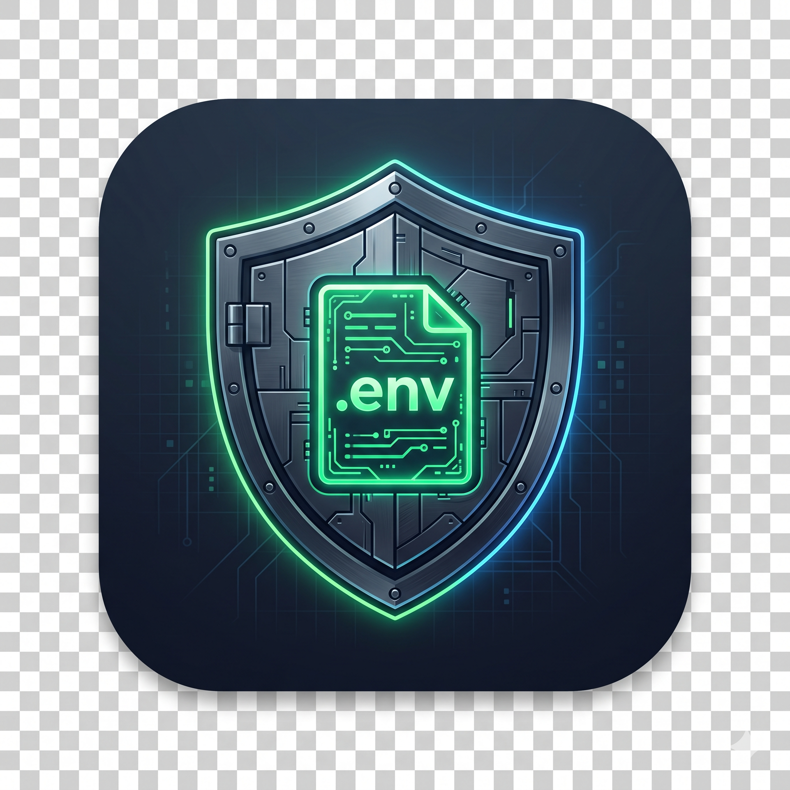

<p align="center">
  
</p>

<h1 align="center">EnvKeeper: Local Secret Vault</h1>

<p align="center">
  <strong>Never lose your local API keys again. Automatically backup, encrypt, and restore <code>.env</code> files linked directly to your GitHub repository identity.</strong>
</p>

<p align="center">
  <a href="https://marketplace.visualstudio.com"></a>
  <a href="LICENSE"></a>
  <a href="#-security-architecture"></a>
  <a href="GUIDE.md"></a>
</p>

---

### 📖 [Click here to read the Complete Step-by-Step User Guide (GUIDE.md)](GUIDE.md)

---

## 💡 Why EnvKeeper?

When building modern applications with AI APIs (like **Google Gemini**, **Groq**, **OpenAI**, **Anthropic**), databases, and third-party services, you keep your secret keys in local `.env` files and add `.env` to `.gitignore`.

* ❌ **The Problem**: You delete your local project folder to save space or switch machines. Later, you `git clone` the repository from GitHub. **Your `.env` file is gone.**
* ❌ **The Frustration**: You have to open 5 different web consoles (Google AI Studio, Groq Cloud, Supabase, Stripe) just to re-generate or copy-paste keys all over again.
* ❌ **The Danger**: Leaving unencrypted `.env.bak` files lying around your computer risks accidental leakage or committing secrets to GitHub.

---

## ✨ Key Features

* 🔗 **100% Automatic Git Remote Matching**: Links your encrypted secrets to your repository's Git Remote URL (`github.com/username/project`). When you clone the repository anywhere on your PC, EnvKeeper recognizes it immediately and offers a **1-click restore**.
* ⚡ **"Go Live" Status Bar Experience**: A live button in your VS Code status bar (bottom right):
  * `$(shield) Backup ENV (2)`: Local `.env` files detected. Click to encrypt and vault.
  * `$(cloud-download) Restore ENV`: Freshly cloned repository detected! Click to restore.
  * `$(check) ENV Protected`: Workspace `.env` files are synced with your vault.
* 📂 **Decoupled Central Vault (`env-keeper-vault/`)**: Backups live safely in your user documents directory (`~/Documents/env-keeper-vault/`). Deleting your project workspace folder **never deletes your backups**.
* 🔐 **Two-Level Envelope Encryption**: 
  * Each project gets a unique 256-bit **Data Encryption Key (DEK)**.
  * The DEK is encrypted with a **Key Encryption Key (KEK)** derived from your Master Passphrase using **PBKDF2 (100,000 iterations + SHA-512)**.
  * Re-keying or changing passphrases is instant because files never need to be decrypted.
* 🗄️ **Google Password Manager & OS Keychain Integration**: Master Passphrase is encrypted in **Windows Credential Manager / macOS Keychain** via VS Code's `SecretStorage`. Includes a 1-click **Copy to Clipboard** button to save it in Google Password Manager, Bitwarden, or 1Password.
* 🛡️ **Smart Collision Guard**: If restoring into a project with existing `.env` files, choose between **View Diff** (side-by-side in VS Code), **Merge Missing Keys**, or **Overwrite with Vault**.
* 🌳 **Activity Bar Explorer**: Inspect vaulted projects, view variable names without decrypting, preview secrets safely, or delete old vaults.

---

## 🔒 Security Architecture

```text
┌────────────────────────────────────────────────────────────────────────┐
│                        User Master Passphrase                          │
│            (Saved in Windows Credential Manager / OS Keychain)         │
└───────────────────────────────────┬────────────────────────────────────┘
                                    │ PBKDF2 (100,000 iters + SHA-512 + salt)
                                    ▼
                        [Key Encryption Key (KEK)]
                                    │
                       Encrypts / Decrypts the DEK
                                    ▼
                       [Data Encryption Key (DEK)]
                     (Unique 256-bit key per project)
                                    │
                         AES-256-GCM Encrypts
                                    ▼
                Encrypted Files in env-keeper-vault/
```

### Vault Directory Layout

```text
env-keeper-vault/
├── vault.config.json                  <-- Vault configuration & verification token
│
├── github.com_user_ai-chat-app/
│   ├── project.meta.json              <-- Encrypted DEK, Git URL, timestamps, file map
│   ├── root.env.enc                   <-- AES-256-GCM encrypted root .env
│   └── client__.env.local.enc         <-- AES-256-GCM encrypted nested env
│
└── github.com_user_ecommerce-api/
    ├── project.meta.json
    └── root.env.enc
```

---

## 🚀 Quick Start

### 1. Backing Up Your Keys (1 Click)
1. Open any project that contains a `.env` file in VS Code.
2. In the bottom-right status bar, click **`$(shield) Backup ENV`**.
3. Enter your Master Passphrase (or generate one with 1 click).
4. Done! Your files are encrypted with AES-256-GCM and vaulted.

### 2. Restoring Keys on a Fresh Clone
1. Run `git clone https://github.com/your-username/your-repo.git`.
2. Open the freshly cloned repository in VS Code.
3. The status bar immediately alerts: **`$(cloud-download) Restore ENV`**.
4. Click the button — your `.env` files are decrypted and placed back into their exact relative locations!

---

## ⌨️ Command Palette Reference

Press `Ctrl+Shift+P` (or `Cmd+Shift+P` on macOS) and type `EnvKeeper`:

| Command | Description |
|---|---|
| `ENV Keeper: Backup Workspace .env Files` | Scans, encrypts, and saves all workspace `.env*` files |
| `ENV Keeper: Restore .env Files from Vault` | Decrypts and restores environment files into workspace |
| `ENV Keeper: Actions Menu` | Opens quick interactive menu for all actions |
| `ENV Keeper: Set or Reset Master Passphrase` | Change passphrase or copy to Google Password Manager |
| `ENV Keeper: Lock Vault` | Clear cached passphrase from memory and OS Keychain |
| `ENV Keeper: View Encrypted Keys in Vault` | View decrypted variables in a temporary preview tab |
| `ENV Keeper: Delete Project from Vault` | Permanently remove a project's backup from vault |
| `ENV Keeper: Refresh Vault Explorer` | Refreshes sidebar explorer and status bar |

---

## ⚙️ Configuration Settings

| Setting | Type | Default | Description |
|---|---|---|---|
| `envKeeper.vaultPath` | `string` | `""` | Custom storage folder path (defaults to `~/Documents/env-keeper-vault`) |
| `envKeeper.showActivityBarIcon` | `boolean` | `true` | Show or hide the ENV Keeper Vault Explorer icon in the primary Activity Bar (left sidebar) |
| `envKeeper.autoBackupOnSave` | `boolean` | `false` | Automatically update vault backup whenever an `.env` file is saved |
| `envKeeper.rememberMasterPassword` | `boolean` | `true` | Securely remember Master Passphrase in OS Keychain |
| `envKeeper.ignoredDirectories` | `array` | `["node_modules", ".git", ...]` | Folder names to exclude during workspace scan |

---

## 📦 Installation

Install directly from the VS Code Marketplace or via terminal:
```bash
code --install-extension envkeeper-0.1.0.vsix
```

---

## 📄 License

MIT License © 2026 Swayam Prabhu & EnvKeeper Contributors. Free and open source.
